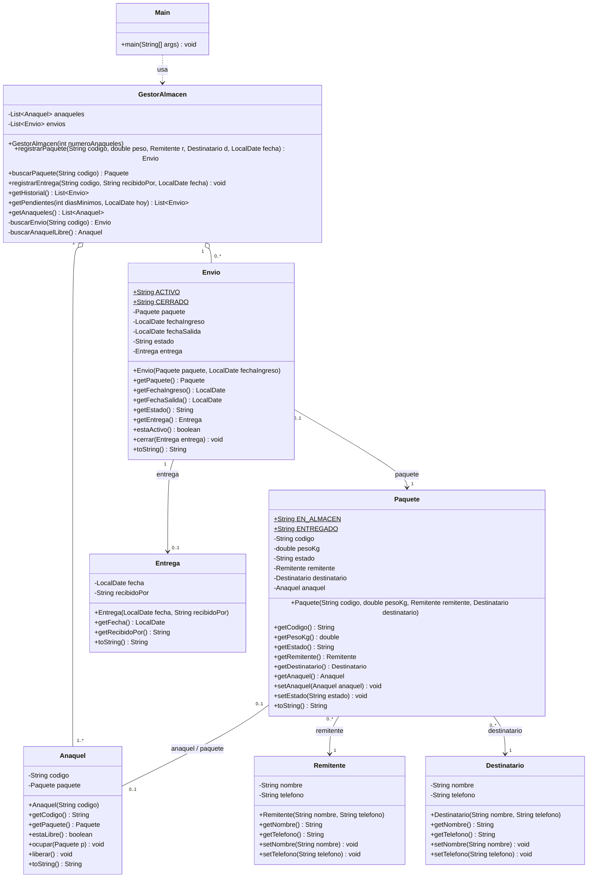

# Plantilla del documento PDF (Segundo avance)

Cada responsable llena su sección en este archivo (rama propia). Al final se junta todo en un solo PDF.

## Portada
Facultad de Ingeniería - Programación Orientada a Objetos
Proyecto: Almacén de Paquetes | Grupo 4
Integrantes: Bolaños Fuentes Juan Manuel, Prado Gutierrez Juan Alejandro, Sánchez Navarro Rodrigo, Villa De Jesús Roberto
Fecha de entrega: 18 de octubre

---

## 1. Revisión del primer avance  — Responsable: Juan Alejandro
- Síntesis de la problemática: La gestión de un almacén de paquetes presenta retrasos y errores en el movimiento de la mercancía, desde que entra hasta que sale para su entrega. Se busca reducir el tiempo y el margen de error en ese proceso.
- Objetivos: Diseñar e implementar, a lo largo del semestre, un sistema de gestión de almacén que reduzca los tiempos de recorrido y procesamiento de paquetes mediante la automatización de la asignación de ubicaciones y la consolidación de envíos. Esta primera versión sienta las bases: el registro, la ubicación y el control de estado de los paquetes. La automatización y el algoritmo de optimización se incorporarán en avances posteriores.
- Alcance: Incluido: registro de paquetes, información de remitentes y destinatarios, asignación y consulta de ubicaciones, control del estado de los paquetes y registro de entregas. Excluido en esta etapa: seguimiento GPS, rutas de transporte, pagos, compras en línea y comunicación con empresas de paquetería.
- Ajustes realizados a partir de la retroalimentación:
  - Del primer avance se pasaron a código seis de los siete objetos preliminares: Paquete, Remitente, Destinatario, Anaquel, Envio y Entrega.
  - El objeto Operador no se implementó en esta etapa porque no aporta lógica propia todavía; queda como siguiente paso.
  - Las ocho funcionalidades propuestas se concentraron en la clase de servicio GestorAlmacen; se demuestran dos de ellas, como pide el avance.
  - Se agregó una carpeta de pruebas y un flujo automático de GitHub (CI) que compila y ejecuta el proyecto en cada cambio.
  - Se hicieron cambios en el apartado de almacen, asi haciendo mejoras en ese apartado tal y como se menciono en la primera retroalimentación.


## 2. Catálogo de clases — Responsable: Juan Alejandro (modelo) y Roberto (servicio)
Para cada clase: responsabilidad, atributos, métodos, relaciones.

### Paquete
- Responsabilidad: Representa un envío individual guardado en el almacén: su código, peso, estado, remitente, destinatario y anaquel asignado. Valida sus propios datos y inicia en estado EN_ALMACEN.
- Atributos:
  - `+EN_ALMACEN: String` {static, final}
  - `+ENTREGADO: String` {static, final}
  - `-codigo: String`
  - `-pesoKg: double`
  - `-estado: String`
  - `-remitente: Remitente`
  - `-destinatario: Destinatario`
  - `-anaquel: Anaquel`
- Métodos:
  - `+Paquete(codigo: String, pesoKg: double, remitente: Remitente, destinatario: Destinatario)`
  - `+getCodigo(): String`
  - `+getPesoKg(): double`
  - `+getEstado(): String`
  - `+getRemitente(): Remitente`
  - `+getDestinatario(): Destinatario`
  - `+getAnaquel(): Anaquel`
  - `+setAnaquel(anaquel: Anaquel): void`
  - `+setEstado(estado: String): void`
  - `+toString(): String`
- Validaciones: Código no vacío; peso mayor a 0; remitente y destinatario obligatorios (IllegalArgumentException).
- Relaciones: Tiene un Remitente y un Destinatario; se guarda en 0..1 Anaquel; es el objeto principal de un Envio.

### Remitente
- Responsabilidad: Representa a la persona o negocio que trae el paquete al almacén. Guarda sus datos de contacto y valida que sean correctos.
- Atributos:
  - `-nombre: String`
  - `-telefono: String`
- Métodos:
  - `+Remitente(nombre: String, telefono: String)`
  - `+getNombre(): String`
  - `+getTelefono(): String`
  - `+setNombre(nombre: String): void`
  - `+setTelefono(telefono: String): void`
  - `+toString(): String`
- Validaciones: Nombre no vacío; teléfono de 10 dígitos (IllegalArgumentException). El constructor usa los setters, por lo que la validación está en un solo lugar.
- Relaciones: Asociada con Paquete (un remitente puede tener varios paquetes; cada paquete tiene un remitente).

### Destinatario
- Responsabilidad: Representa a la persona que recogerá el paquete. Guarda su nombre y teléfono y valida que sean correctos.
- Atributos:
  - `-nombre: String`
  - `-telefono: String`
- Métodos:
  - `+Destinatario(nombre: String, telefono: String)`
  - `+getNombre(): String`
  - `+getTelefono(): String`
  - `+setNombre(nombre: String): void`
  - `+setTelefono(telefono: String): void`
  - `+toString(): String`
- Validaciones: Nombre no vacío; teléfono de 10 dígitos (IllegalArgumentException). El constructor usa los setters, por lo que la validación está en un solo lugar.
- Relaciones: Asociada con Paquete (un destinatario puede recibir varios paquetes; cada paquete tiene un destinatario).

### Anaquel
### Envio
### Entrega
### GestorAlmacen
### Operador (si se implementa)



**Notación:** `+` público, `-` privado. El rombo vacío indica que `GestorAlmacen` contiene a los Anaqueles y Envíos; la línea punteada es una dependencia (Main usa `GestorAlmacen`).

| Clase origen | Relación | Clase destino | Multiplicidad |
|---|---|---|---|
| Main | Dependencia (usa) | GestorAlmacen | — |
| GestorAlmacen | Agregación (contiene) | Anaquel | 1 a 1..* |
| GestorAlmacen | Agregación (contiene) | Envio | 1 a 0..* |
| Envio | Asociación "paquete" | Paquete | 0..1 a 1 |
| Envio | Asociación "entrega" | Entrega | 1 a 0..1 |
| Paquete | Asociación "remitente" | Remitente | 0..* a 1 |
| Paquete | Asociación "destinatario" | Destinatario | 0..* a 1 |
| Paquete | Asociación bidireccional | Anaquel | 0..1 a 0..1 |

## 4. Organización en paquetes — Responsable: Juan Manuel

```
Proyecto-Integrador-ALMACEN-DE-PAQUETES/
├── src/
│   ├── modelo/     Paquete, Remitente, Destinatario, Anaquel, Envio, Entrega
│   ├── servicio/   GestorAlmacen
│   └── app/        Main
├── tests/          PruebasAlmacen.java
├── docs/           Documento, UML y evidencias
└── README.md       Cómo compilar y ejecutar
```

| Paquete | Responsabilidad | Por qué está separado |
|---|---|---|
| `modelo` | Representa los datos del dominio y valida su propia información. | Las clases de datos no dependen de la lógica ni de la ejecución; se pueden reutilizar y probar solas. |
| `servicio` | Contiene las reglas del almacén (registrar, ubicar, entregar, consultar). | Separa la lógica de negocio de los datos; aquí irá el algoritmo de optimización. |
| `app` | Punto de entrada y demostración. | Mantiene la ejecución aparte, de modo que el servicio pueda usarse luego con otra interfaz. |

Dependencias mediante `import`: `app` importa `servicio` y `modelo`; `servicio` importa `modelo`; `modelo` no depende de ningún otro paquete.

## 5. Implementación en Java — Responsable: Juan Manuel

- **Encapsulamiento:** todos los atributos son `private`; acceso mediante getters y setters.
- **Constructores con validación:** se rechazan datos inválidos con `IllegalArgumentException` o `IllegalStateException`.
- **Relaciones entre objetos:** `Paquete` guarda `Remitente`, `Destinatario` y `Anaquel`; `Envio` guarda su `Paquete` y su `Entrega`; `GestorAlmacen` guarda listas de `Anaquel` y `Envio`.
- **Estados:** el paquete pasa de `EN_ALMACEN` a `ENTREGADO` y el envío de `ACTIVO` a `CERRADO`.
- **Uso de `import` entre paquetes** y **sin código de relleno**.

| Clase | Regla | Excepción |
|---|---|---|
| Remitente / Destinatario | Nombre no vacío; teléfono de 10 dígitos | `IllegalArgumentException` |
| Paquete | Código no vacío; peso mayor a 0; remitente y destinatario obligatorios | `IllegalArgumentException` |
| Anaquel | No se ocupa un anaquel ya ocupado ni con paquete nulo | `IllegalArgumentException` / `IllegalStateException` |
| Envio | No se cierra dos veces; entrega obligatoria y no anterior al ingreso | `IllegalStateException` / `IllegalArgumentException` |
| Entrega | Fecha obligatoria; quien recibe no vacío | `IllegalArgumentException` |
| GestorAlmacen | Sin códigos duplicados; sin anaqueles libres no se registra | `IllegalArgumentException` / `IllegalStateException` |

| # | Funcionalidad | Método |
|---|---|---|
| 1 | Registrar un paquete nuevo | `GestorAlmacen.registrarPaquete` |
| 2 | Asignar un anaquel | `GestorAlmacen.registrarPaquete` (usa `buscarAnaquelLibre`) |
| 3 | Buscar un paquete por código | `GestorAlmacen.buscarPaquete` |
| 4 | Registrar la entrega | `GestorAlmacen.registrarEntrega` |
| 5 | Cambiar estado del paquete y del envío | `Paquete.setEstado`, `Envio.cerrar` |
| 6 | Ver el historial de envíos | `GestorAlmacen.getHistorial` |
| 7 | Dejar libre el anaquel | `Anaquel.liberar` |
| 8 | Ver paquetes pendientes | `GestorAlmacen.getPendientes` |

## 6. Funcionalidades y pruebas — Responsable: Roberto

Se demuestran dos funcionalidades desde `app.Main`, con fecha fija (15 de octubre de 2026) para que el resultado sea reproducible.

```
javac -d out src/modelo/*.java src/servicio/*.java src/app/*.java tests/*.java
java -cp out app.Main
java -cp out PruebasAlmacen
```

### Prueba 1: registrar un paquete y asignarle anaquel

| Elemento | Descripción |
|---|---|
| **Entrada** | Remitente: Tienda La Esquina (5512345678). Destinatario: Ana López (5587654321). Paquete PQ-001, 2.5 kg, ingreso 10/oct/2026. Después, un registro con peso -1. |
| **Resultado esperado** | El paquete queda EN_ALMACEN en A-01 con envío ACTIVO. El peso -1 se rechaza con "El peso debe ser mayor a 0." y el paquete aparece en pendientes. |
| **Resultado obtenido** | La salida coincide con lo esperado (ver Figura 1). |

```
=== PRUEBA 1: Registrar paquete y asignar anaquel ===
Registrado: Envío [PQ-001] ingreso 2026-10-10 | ACTIVO
Paquete PQ-001 | 2.5 kg | EN_ALMACEN | A-01 | De: Tienda La Esquina | Para: Ana López

Caso de error (peso inválido):
Error controlado: El peso debe ser mayor a 0.

Pendientes con 3+ días guardados:
Envío [PQ-001] ingreso 2026-10-10 | ACTIVO
```

### Prueba 2: registrar la entrega

| Elemento | Descripción |
|---|---|
| **Entrada** | Entrega del paquete PQ-001 el 15/oct/2026, recibido por Ana López. |
| **Resultado esperado** | El paquete pasa a ENTREGADO sin anaquel, el envío a CERRADO y A-01 queda libre. |
| **Resultado obtenido** | La salida coincide con lo esperado (ver Figura 1). |

```
=== PRUEBA 2: Registrar entrega ===
Paquete PQ-001 | 2.5 kg | ENTREGADO | sin anaquel | De: Tienda La Esquina | Para: Ana López
Historial:
Envío [PQ-001] ingreso 2026-10-10 | CERRADO | Entrega el 2026-10-15 a Ana López

Estado de anaqueles:
A-01 [libre]
A-02 [libre]
A-03 [libre]
```

**Pruebas automáticas (`tests/PruebasAlmacen.java`):** las 12 verificaciones salen `[OK]` y el programa termina con "Todas las pruebas pasaron."


## 7. Reflexión y plan — Responsable: Roberto

**Decisiones de diseño**
- **Separación entre Paquete y Envío:** el paquete es el objeto físico y el envío gestiona el trámite y su estado.
- **Asociación bidireccional entre Anaquel y Paquete:** permite saber qué paquete ocupa una ubicación y liberarla sin recorrer toda la lista.
- **Centralización en GestorAlmacen:** las reglas de negocio están en un solo lugar.
- **Pruebas deterministas:** las fechas (`LocalDate`) se pasan por parámetro.
- **`toString()` en las clases del modelo** para imprimir objetos de forma legible.

**Problemas técnicos encontrados**
- **Liberación limpia de anaqueles** al pasar el paquete a ENTREGADO.
- **Manejo de excepciones** con `try-catch` para pesos negativos y códigos duplicados.
- **Orden al registrar:** el paquete se valida antes de ocupar el anaquel.
- **Coordinación entre integrantes:** al dejar el trabajo para los últimos días no nos dividimos equitativamente lo solicitado, por lo que acudimos a la IA para distribuir la realización del proyecto.
- **Código en GitHub:** tuvimos problemas para integrar los códigos porque en formato ZIP no podíamos descomprimirlos para añadirlos al repositorio.

**Plan para los siguientes avances**
- Incorporar la clase **Operador** (empleado responsable de cada recepción y entrega).
- Algoritmos de asignación automática de anaqueles por dimensiones, peso o categoría, y consolidación de envíos.
- Menú interactivo en consola y persistencia de datos.
- Herencia, polimorfismo y enumeraciones cuando el curso los cubra.

## 8. Participación del equipo

| Integrante | Responsabilidad |
|---|---|
| Bolaños Fuentes Juan Manuel | Paquete app (Main), README, integración del repositorio. Secciones 4 y 5. |
| Prado Gutierrez Juan Alejandro | Clases Paquete, Remitente y Destinatario. Secciones 1 y 2. |
| Sánchez Navarro Rodrigo | Clases Anaquel, Envio y Entrega. Diagrama UML (sección 3). |
| Villa De Jesús Roberto | Clase GestorAlmacen, pruebas y evidencias. Secciones 6 y 7. |